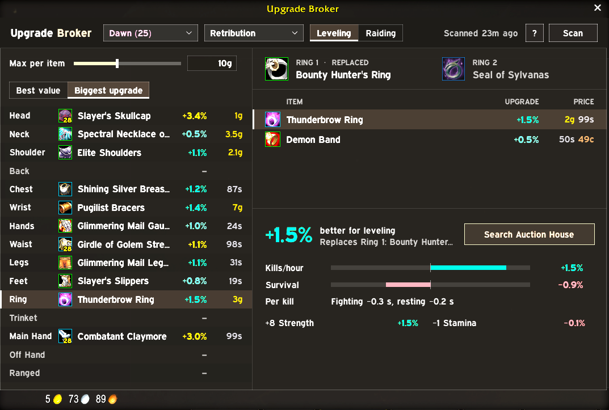

## Summary

Finds WoW Forever gear upgrades on the Auction House and rates items as one percentage in tooltips, bags, and quest rewards.

## Description

Upgrade Broker scans the Auction House on WoW Forever and rates gear against what your character wears as one percentage. It lists the best upgrade per slot with price and shows upgrade ratings in bags, on quest rewards, and in item tooltips.

### Features

- **Auction House upgrades:** Runs its own full scan or reads Auctionator's full scan, keeps the cheapest buyout per item variant, and lists the best upgrade per slot with price.
- **Sort and price limit:** Order by **Best value** or **Biggest upgrade**, and set a **Max per item** limit.
- **Upgrades tab:** Opens in an **Upgrades** tab in the Auction House or anywhere with `/ub`. **Search Auction House** opens the item in the Auction House Buy view (addons cannot buy items on WoW Forever).
- **Stat breakdown:** Shows each changed stat with its share of the total, plus seconds per kill saved fighting and resting while leveling.
- **Bags, quests, and tooltips:** Adds upgrade badges in Blizzard bags and EllesmereUI Bags, marks quest rewards (frames the best usable choice, or puts a coin on the highest vendor value when nothing is an upgrade), and adds a rating line to item tooltips.
- **Alts and specs:** Remembers every character you log in on (same realm and faction) so you can shop for alts from a bank character. Spec is detected from talents.
- **Upcoming levels and usability filters:** Shows gear a few levels ahead in amber with its required level. Skips gear the character cannot use based on armor type (option: main armor type only), weapon skills, class restrictions, and professions (such as engineering goggles).
- **EllesmereUI support:** Settings live in the EllesmereUI options panel when installed, and the window follows EllesmereUI's theme.

### How scores work

Every item gets one percentage showing how much stronger the character gets.

- **Leveling:** Mostly more kills per hour from a kill cycle (fighting, walking, eating and drinking, sitting down) using WoW Forever game data (mob health and damage per level, food and water, main spell ranks), plus a small share for survival.
- **Raiding:** Damage on a boss three levels above you, or healing for healers. Combat rules follow [wowsims/forever](https://github.com/wowsims/forever).
- **Not counted:** Use effects, procs, and set bonuses. Casters count only their main spell.

### Commands

- `/ub`: Open or close the upgrade window.
- `/ub item <link>`: Print the full rating for an item in chat.
- `/ub forget <name>`: Remove a remembered character.
- `/ub options`: Open settings.
